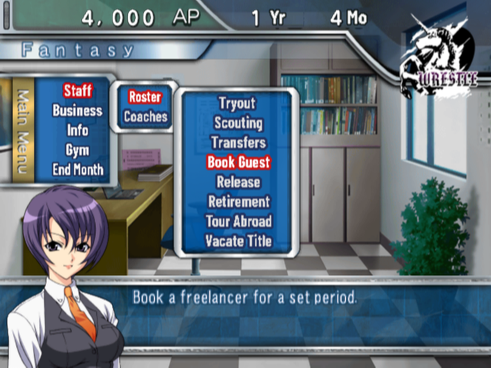
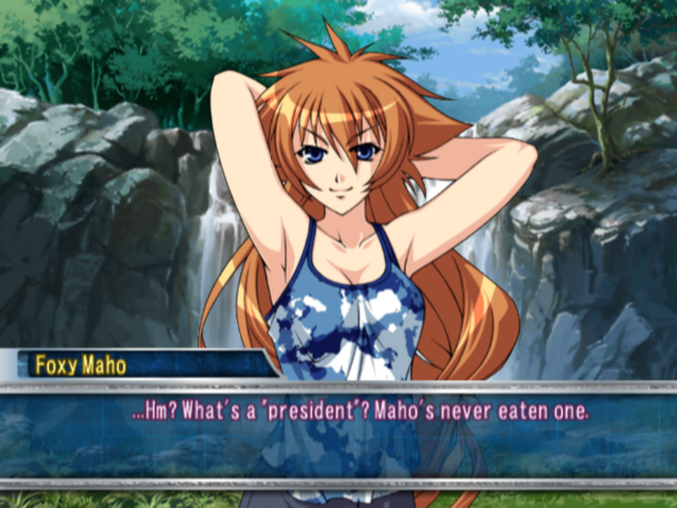
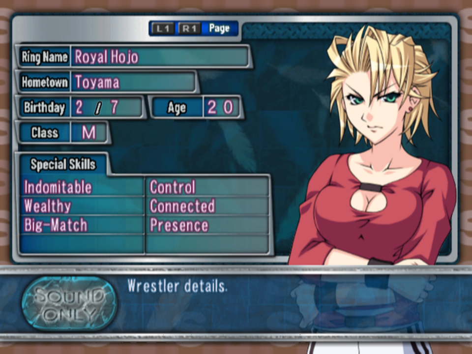
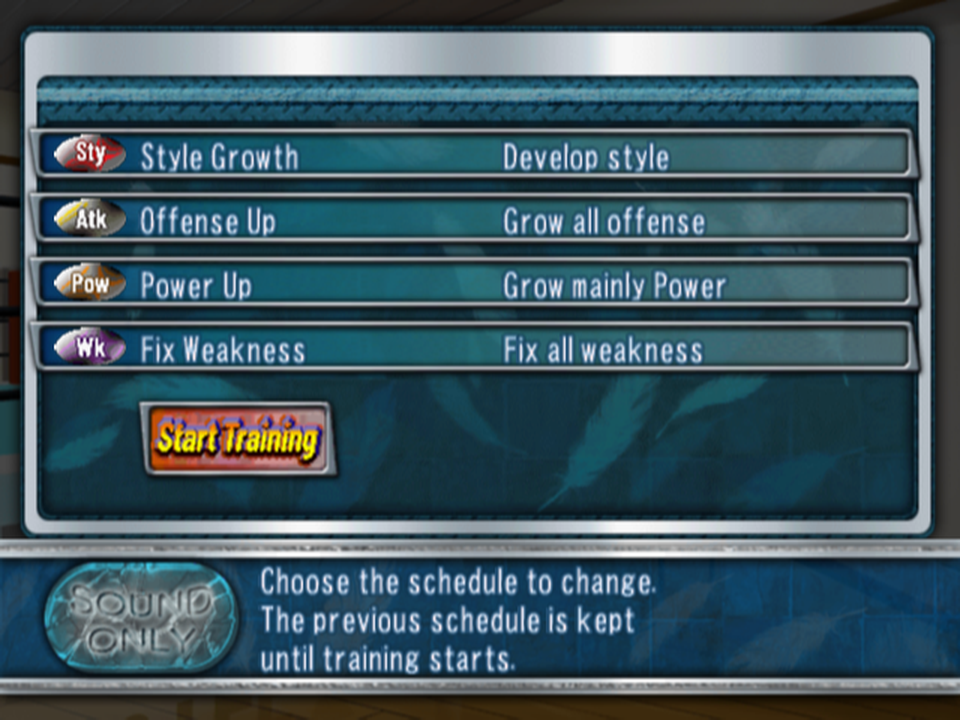
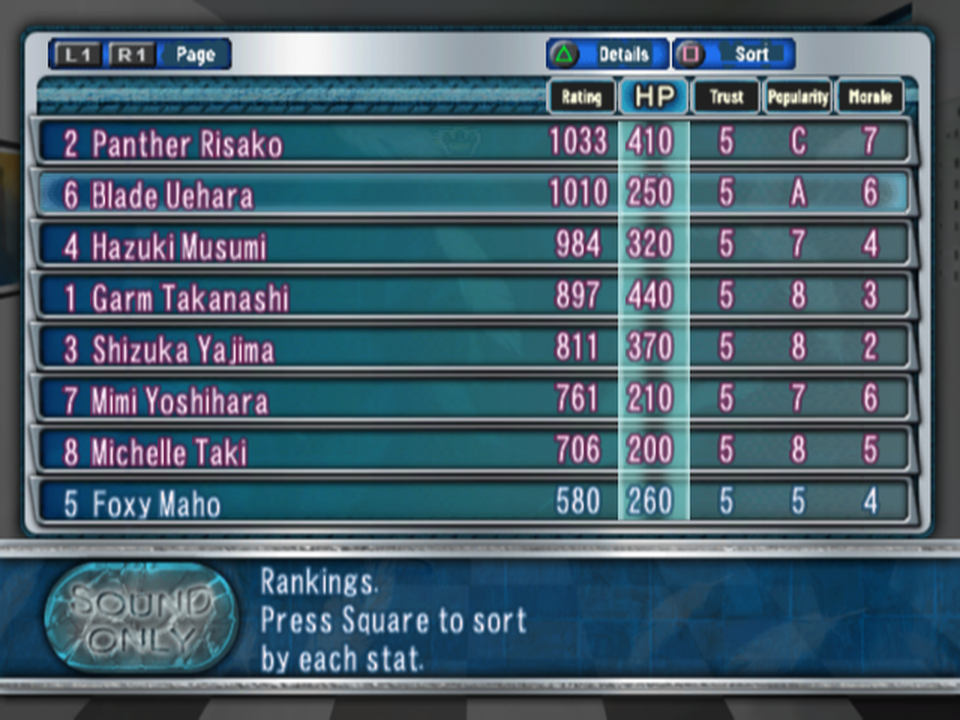
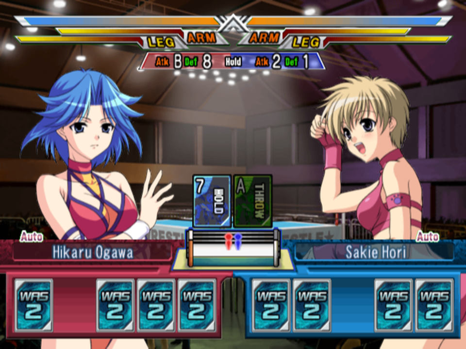
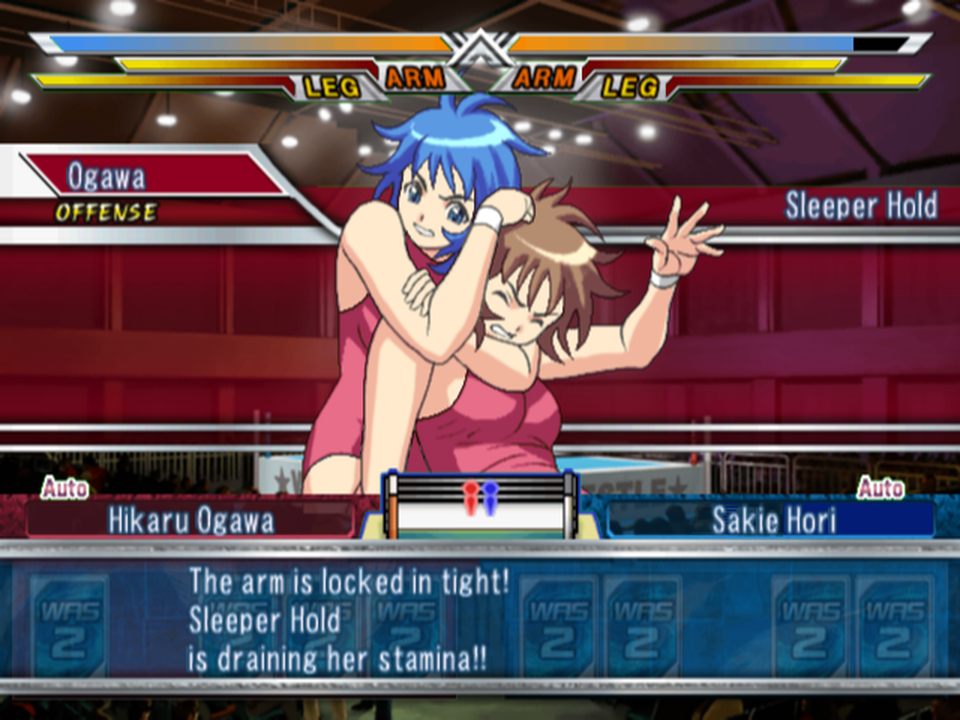

# Screenshots

Wrestle Angels: Survivor 2 with the English patch, taken in PCSX2 at the native resolution. Made with
`tools/shots.py` (docs/RELEASING.md, step 3).

## The office

The main menu, its submenus and the help line, all re-lettered or in the new proportional font.

## Story scenes

Each of the 242 story scripts is translated, with speaker names in the name box.

## Wrestler profile

The status screens: field labels re-lettered in the original style, ring names, hometowns and
special skills translated.

## Training

The training schedule, with the new stat icons and the "Start Training" button.

## Rankings

List headers re-lettered (Rating, Trust, Popularity, Morale) to fit the original columns.

## Match: the cards

The move-type cards, with the English word running down each card like the original kanji.

## Match: commentary

Move names and the play-by-play commentary.
